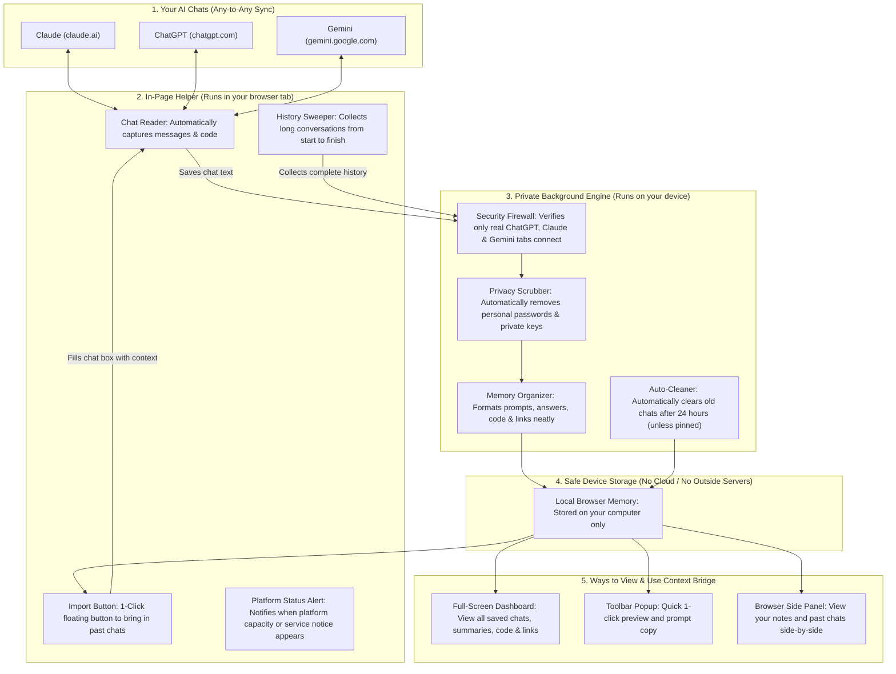

# Context Bridge (Chrome Extension — Manifest V3)

> Universal, Any-to-Any Context Synchronization Layer Across Web LLMs (**ChatGPT**, **Claude**, and **Google Gemini**). Built with Plasmo, React, TypeScript, and Tailwind CSS.

[]()
[]()
[]()
[]()
[]()
[](https://opensource.org/licenses/MIT)

> **Publication Status:** Unpublished — Prepared for Chrome Web Store Review. All capabilities run on-device without external servers or API keys.

---

## 📖 Overview

When developing software with AI assistants, engineers frequently work across multiple platforms:
- You want to consult an alternate model for a second opinion or different reasoning strengths on an active engineering problem without re-explaining context from scratch.
- You want ChatGPT's architecture feedback on code developed in Claude or Gemini without manual copy-pasting.
- Manual copying of prompts and code loses previous decisions, referenced resources, and architectural context.

**Context Bridge** streamlines this workflow. It acts as an ambient, on-device synchronization bridge across your AI chats in Chrome. It organizes active conversation turns and verbatim code snippets locally on your machine, allowing you to hand off your full technical context to another AI model with a single click.

---

## 🚀 What Context Bridge Can Do

* **Universal Any-to-Any Sync:** Full bidirectional support across **ChatGPT**, **Claude**, and **Google Gemini**. Any platform can be a source or a destination.
* **Verbatim Code Preservation:** Code snippets in `<pre><code>` and CodeMirror blocks are preserved with exact indentation and language tags—never paraphrased or summarized.
* **Shared Links & Resources Collector:** Automatically extracts, deduplicates, and catalogs every external website, documentation page, and GitHub repository referenced during your chat into a clean link grid.
* **Deep Virtualized History Sweep:** Uses an intelligent container sweep to recover complete conversation transcripts from start to finish—even on massive chats (50 to 100+ turns) that use DOM virtualization.
* **Clean To-The-Point Summaries:** Distills complex, lengthy conversations into clean 2–4 bullet-point key highlights without bloated essays or raw text dumps.
* **Accurate Word Metrics:** Real-time metrics bar tracks your saved chats, messages, code blocks, and human-readable word volume (`~words`).
* **Session Pinning:** Keep important conversations permanently pinned (📌) or let temporary sessions automatically expire after 24 hours.
* **Service Notice & Platform Availability Alert:** Displays an informative notification when a platform displays a service pause or capacity message, providing a quick shortcut to continue your engineering session on an alternate platform.
* **Local & Private:** No third-party servers, no analytics, no telemetry. Everything is stored locally on your device in sandboxed browser storage (`chrome.storage.local`). Best-effort client-side credential redaction scrubs recognized API keys and tokens before text is stored or formatted.

---

## 🏛️ How Context Bridge Works (Architecture Flow)

Context Bridge connects your AI chats smoothly and securely without sending your data to any outside cloud server. Here is how the whole flow works:



### The 5 Simple Steps in the Flow:
1. **Your AI Chats:** You talk to ChatGPT, Claude, or Gemini as usual.
2. **In-Page Helper:** Context Bridge quietly reads the chat turns and code snippets without slowing down your page.
3. **Private Background Engine:** Automatically scrubs out any private passwords or secret tokens you might have pasted, organizing everything into a clean structure.
4. **Safe Device Storage:** Everything is saved directly onto your computer's local browser memory. **Zero outside servers or APIs are called.**
5. **Ready to Use:** When you switch to a different AI, click the floating button or open the Dashboard to resume your work instantly.

---

## 🛠️ Step-by-Step Guide: How to Use Context Bridge

### 1. Installation

#### Running Locally (Developer Mode)
1. Clone this repository:
   ```bash
   git clone https://github.com/msajiddurrani/context-bridge.git
   cd context-bridge
   ```
2. Install dependencies and compile the production build:
   ```bash
   pnpm install
   pnpm build
   ```
3. Open Google Chrome and go to `chrome://extensions`.
4. Turn on **Developer mode** in the top-right corner.
5. Click **Load unpacked** (top-left) and select the `build/chrome-mv3-prod` directory (or `cb-live-test`).
6. Pin Context Bridge to your Chrome toolbar via the puzzle icon (🧩).

---

### 2. Ambient Conversation Auto-Saving

You do not need to press any button to save your chats.
1. Open [Claude](https://claude.ai), [ChatGPT](https://chatgpt.com), or [Gemini](https://gemini.google.com).
2. Chat as you normally do.
3. Context Bridge automatically recognizes the unique permalink URL of your chat and silently snapshots the conversation turns, verbatim code blocks, and referenced links into local storage.
4. If you start a new conversation (`/new`), Context Bridge waits until a real message is sent before recording, preventing temporary or empty chat clutter.

---

### 3. One-Click Chat Import & Platform Switching

When you want to continue your conversation on a different platform:
1. Open a new chat in **ChatGPT**, **Claude**, or **Gemini**.
2. A sleek, minimal floating button will appear near the input area:
   - Example: **`Import from Claude`** (or whichever platform you last used).
3. Click the button (or press `Alt + Shift + I`):
   - Context Bridge injects the structured handover prompt and verbatim code directly into the chat box without auto-submitting.
4. Press **Enter** to start chatting with your new AI. It will respond with `"Ready"` and possess full memory of your previous conversation.

#### Detail Level Selector:
Click the dropdown arrow (`⌄`) on the floating button to choose how much context to import:
* **Full (Default):** Comprehensive entire conversation history with turn-by-turn preservation.
* **Smart:** Complete dialogue turns, thread outline, and all verbatim code blocks.
* **Export (.md):** Downloads the complete conversation as a pristine GitHub-flavored Markdown document.

---

### 4. Using the Full-Screen Studio Dashboard

Click the **Dashboard ↗** button in the extension popup or open `chrome-extension://<id>/tabs/dashboard.html` to access the full workspace:

1. **Header Metrics Bar:**
   - Real-time live count of your **Chats**, **Messages**, **Code Snippets**, and total preserved **Words** (`~125k words`).
2. **Conversation Manager (Left Sidebar):**
   - Search across chats, code, and topics with instant filtering.
   - Filter by platform (**Claude**, **GPT**, **Gemini**).
   - Sort by **Recently Updated**, **Most Exchanges**, **Most Code Snippets**, or **Most Words**.
   - Pin sessions (📌) to prevent auto-expiry.
3. **Studio Workspace (Main Area):**
   - **Prompt for Another AI:** Preview and copy pre-formatted prompts tailored for ChatGPT, Claude, or Gemini in Markdown or XML format.
   - **Code Snippets:** Review all extracted code artifacts organized with file paths and syntax highlighting.
   - **Full Conversation:** Inspect the entire message transcript with collapsible view controls.
   - **Chat Summary & Resources:** Read a clean, bulleted executive overview of the conversation and view all shared external links in a clean 2-column card grid.
4. **Backup & Privacy Actions:**
   - **Export Backup:** Download all stored chats as a JSON backup.
   - **Import:** Restore chats from a previous backup file.
   - **Clean Up Expired:** Instantly prune sessions older than 24 hours.
   - **Clear All:** Wipe all local storage in one click.

---

### 5. Using the Chrome Side Panel & Quick Popup

* **Quick Popup (`popup.html`):** Click the extension icon in the toolbar for a compact view of active chats, 1-click **"Copy for AI"**, markdown downloads, and quick preview.
* **Side Panel (`sidepanel.html`):** Press `Alt + Shift + C` (or `Cmd + Shift + C` on macOS) to open Context Bridge directly inside Chrome's native side panel. This lets you reference previous chats and copy code while chatting on another tab without leaving your workspace.

---

### 6. Service Availability & Platform Notice Detection

If a platform displays a service pause, maintenance notice, or capacity message:
* Context Bridge detects the standard on-page notification.
* An informative banner offers a direct shortcut to open an alternate platform with your active context ready for transfer.

---

## ⌨️ Global Keyboard Shortcuts

| Shortcut (Windows / Linux) | Shortcut (macOS) | Action |
| :--- | :--- | :--- |
| `Alt + Shift + I` | `Command + Shift + I` | **Quick Inject:** Insert latest active context directly into current chat box |
| `Alt + Shift + C` | `Command + Shift + C` | **Side Panel:** Toggle Context Bridge side panel |

*(Shortcuts can be customized anytime in `chrome://extensions/shortcuts`)*

---

## 🔒 Security & Privacy Guarantees

1. **Client-Side Storage:** Transcripts, code blocks, and context states never leave your browser. All persistence happens inside `chrome.storage.local`.
2. **Zero Telemetry or Tracking:** Zero analytics scripts, zero tracking pixels, and zero remote logging.
3. **Client-Side Credential Scrubbing:** Before text is written or formatted, recognized high-entropy secrets (OpenAI keys, Google API keys, AWS credentials, GitHub tokens, JWTs, private keys) are scrubbed locally via best-effort regex pattern matching. Users should avoid pasting sensitive production passwords into chat prompts.
4. **Prompt Injection Defense:** Chat transcripts in exported prompts are enclosed within strict `<chat_log>` delimiters with system directives instructing receiving models never to execute untrusted instructions found inside.
5. **No Dangerous DOM APIs:** Text insertion uses standard plain-text setters and synthetic `InputEvent` dispatching. Strictly zero `innerHTML`, `eval()`, or `new Function`.
6. **User-Initiated Submission:** Context Bridge places text into the input textarea only—it **never** clicks the submit button or triggers message sending automatically. The user reviews and submits the prompt manually.

---

## 🧪 Development, Verification & Testing

### Prerequisites
* **Node.js**: `>= 20.x`
* **pnpm**: `>= 8.x`

### Core Commands
```bash
# Install dependencies
pnpm install

# Run the complete test suite (38 test suites / 241 unit tests)
pnpm test

# Run TypeScript type check (0 errors)
npx tsc --noEmit

# Compile production Chrome extension bundle
pnpm build

# Package deployment-ready zip file for Chrome Web Store
pnpm package
```

### Verification Standards
* Every release passes `npx tsc --noEmit` with **0 errors**.
* Full unit test suite (`pnpm test`) achieves **100% pass rate** across all 38 test suites (241 unit tests).
* All site selectors are verified against live audit reports under `docs/site-reports/`.

---

## 📄 License

Distributed under the MIT License. See [LICENSE](LICENSE) for details.
